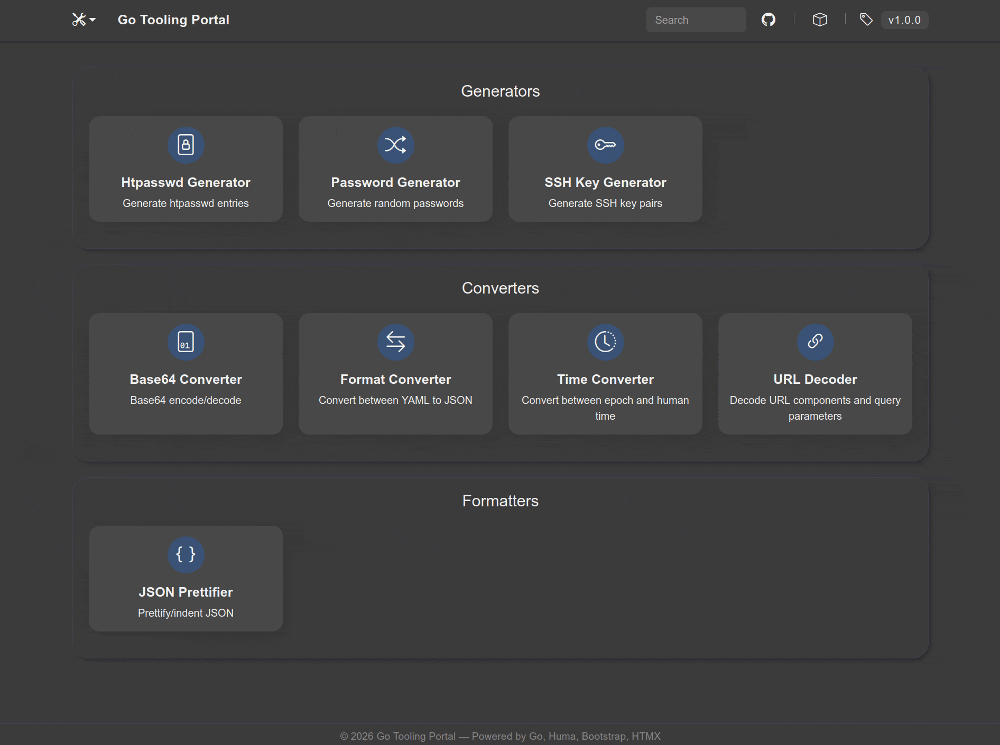

# GO TOOLING PORTAL

## What is it?

A simple, fast, self-hosted web app with handy developer tools so you can avoid pasting potentially sensitive data into third-party websites.

- **Htpasswd Generator**: Generate htpasswd entries using Apache-variant MD5 (`apr1`), MD5, SHA256, or SHA512.
- **Password Generator**: Generate random passwords with a configurable length and character sets.
- **SSH Key Generator**: Generate SSH key pairs.
- **JSON Prettifier**: Format or minify JSON.
- **Format Converter**: Convert between YAML and JSON.
- **Time Converter**: Convert between Unix timestamps and human-readable dates and times.
- **Base64 Converter**: Encode or decode data using Base64.
- **URL Decoder**: Parse URLs and decode their components and query parameters.

___

## Run it inside containers

### Docker build

- Make sure you have docker and git installed on your machine
- Git clone the repo: `cd ~ && git clone https://github.com/sfarosu/go-tooling-portal.git && cd ~/go-tooling-portal && git checkout master`
- Build the image: `cd ~/go-tooling-portal && docker build -t docker.io/sfarosu/go-tooling-portal:latest -f Dockerfile .`
- Run the container daemonized : `docker run --rm -d -p 8100:8100 docker.io/sfarosu/go-tooling-portal`
- Access it in your browser at: [http://localhost:8100](http://localhost:8100)

### Docker run - use the prebuilt image from docker hub

- `docker run --rm -d -p 8100:8100 docker.io/sfarosu/go-tooling-portal:latest`
- Access it in your browser at: [http://localhost:8100](http://localhost:8100)

### Docker compose

- Run it with: `docker-compose -f deployments/docker-compose/docker-compose.yaml up`
- Stop it with: `docker-compose -f deployments/docker-compose/docker-compose.yaml down`
- Access it in your browser at: [http://localhost:8100](http://localhost:8100)

### Kubernetes

- create the deployment: `kubectl create -f deployments/kubernetes/deployment.yaml`
- create the svc: `kubectl create -f deployments/kubernetes/svc.yaml`
- create your kubernetes/ingress or openshift/route

___

## Docs

- For setup, development, tests, and API documentation, see the [Developer Guide](docs/developer-guide.md).
- For versioning and release instructions, see the [Release Guide](docs/release-guide.md).
